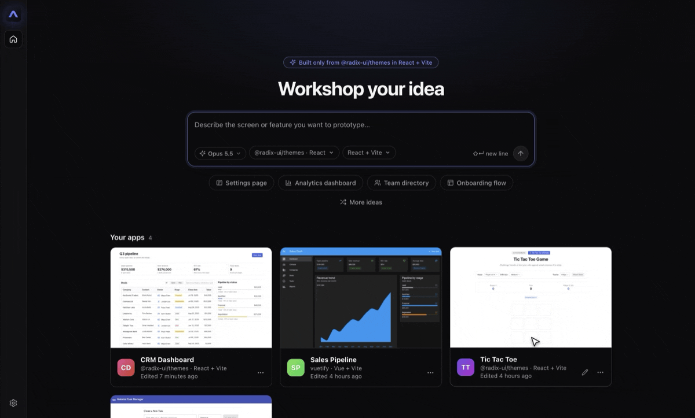
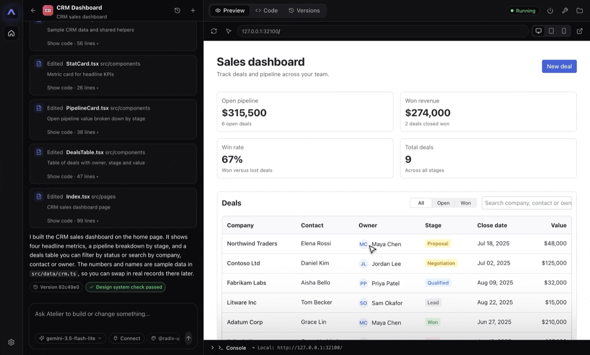
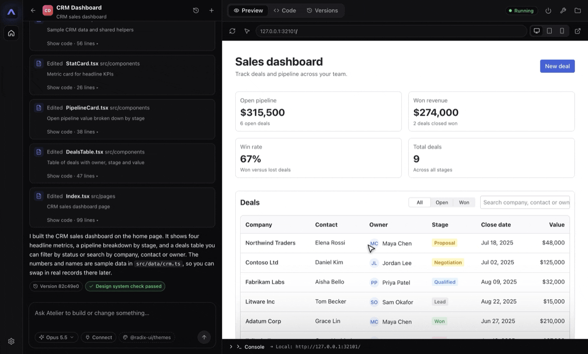
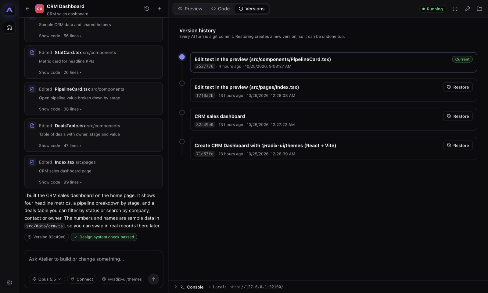
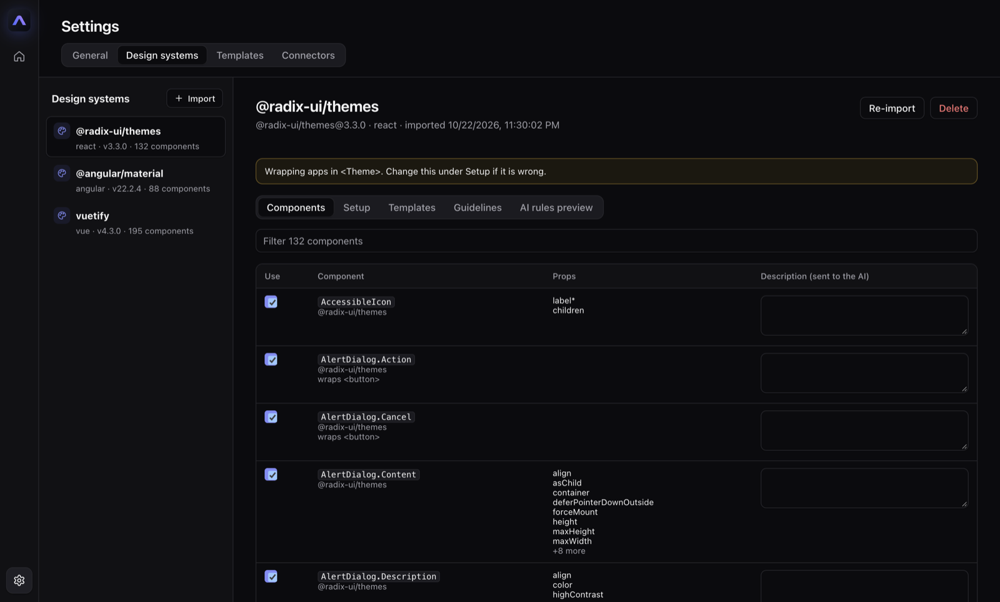
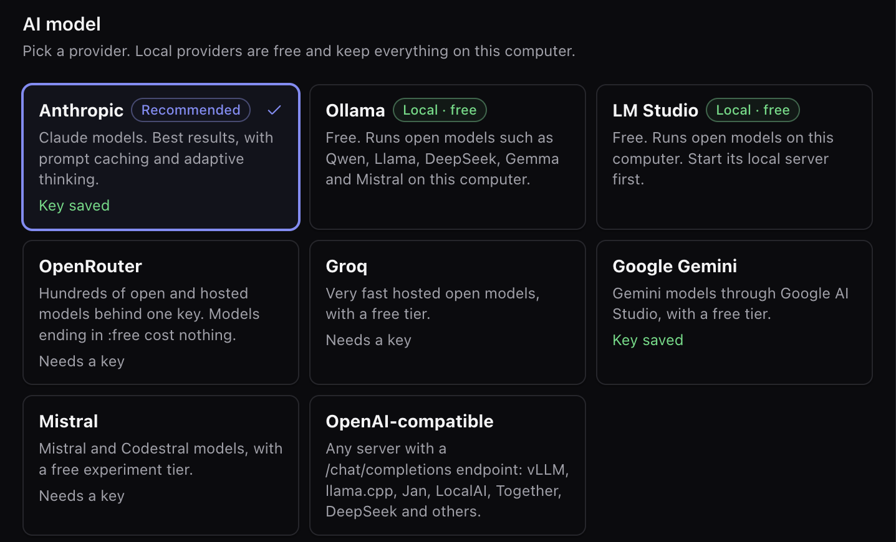

  <picture>
    <source media="(prefers-color-scheme: dark)" srcset="assets/atelier/svg/atelier-wordmark-dark.svg">
    
  </picture>

<h3 align="center">Prototype with your real design system, just by describing what you want.</h3>

  Atelier is a desktop app that turns a chat into a working prototype built only from <em>your</em> company's components. 
  Designers, product managers and partners get real, clickable screens. Engineers get code they can actually ship.

  <a href="../../releases/latest"><strong>Download for macOS, Windows or Linux</strong></a>
  ·
  <a href="#how-it-works">How it works</a>
  ·
  <a href="#built-for-company-use">Security and privacy</a>

  
   
  One sentence in, a working support inbox out, built only from Radix Themes. Waiting time is sped up.

## Why Atelier

Most AI app builders give you something that looks like a generic template. Then an engineer has to rebuild it before it can go anywhere near your product. Atelier works the other way round.

- **Your components, nothing else.** Import your component library and Atelier builds every screen from it. A built-in check flags anything that slips outside your design system.
- **Real, running apps.** Each prototype is a live app with working navigation, state and interactions, not a static mockup.
- **Code engineers can use.** The output is a plain git repository with readable code and a full version history.
- **Runs on your computer.** Your apps, code and keys stay on your machine. Choose a cloud model or run one locally.

## Built for your whole team

| | |
|---|---|
| 🎨 **Designers** | Explore ideas in the real components instead of redrawing them. Fine-tune by clicking on the page: change text, reorder elements, or ask the AI to adjust one part. |
| 📋 **Product managers** | Turn a feature idea into a clickable prototype in minutes. Bring it to user testing or stakeholder reviews without waiting for a sprint. |
| 🤝 **Partners, agencies and SDK users** | Build on-brand screens that follow your platform's design system from the first draft, without learning its internals. |
| 🛠️ **Engineers** | Get prototypes as normal React, Vue or Angular projects that use the same components as production. Read the diff, then lift the code into the product. |
| 🧩 **Design system teams** | Decide which components are in play, add usage guidelines, and see the exact rules the AI receives. Every screen is checked against your system. |

## See it in action

### Point, click and change

Turn on the select tool and click anything in the preview. Double-click text to rewrite it right on the page, then save: Atelier updates the source code and makes a new version.

### Ask AI about one element

Select an element and tell the AI what to change. The element is sent with your request, so the AI changes the right thing and leaves the rest alone.

### Never lose a good version

Every change is saved as a version. Look back through the history and restore any earlier state; restoring is itself a new version, so you can always undo it.

## How it works

1. **Import your design system.** Point Atelier at your npm package, public or private, or at a local folder. It reads every component and its props, plus your styles, tokens and theme provider.
2. **Describe what you want.** Atelier builds a starter app that loads your design system, then writes the screens you ask for.
3. **Refine.** Keep chatting, edit directly in the live preview, or open the code.
4. **Hand off.** Each app is a plain git repository on your computer, ready for an engineer to pick up.

The component catalog: choose which components the AI may use and describe how to use them.

## Works with your stack

- **Frameworks:** React, Vue 3 and Angular (17 to 22).
- **Design systems:** any component library published as an npm package with TypeScript types, such as Radix Themes, MUI, Mantine, Vuetify, PrimeVue, Element Plus, PrimeNG or Angular Material. Vuetify, PrimeVue, PrimeNG and Angular Material are set up automatically.
- **Your own starter app:** import your product shell as a template, from a folder or a git repository, so prototypes look and feel like the real product.
- **Nothing else to install:** Atelier ships with its own Node.js and git.

## Bring your own AI model

Use Claude for the best results, or keep everything on your computer with a free local model.

Supported providers: Anthropic (Claude), Ollama, LM Studio, OpenRouter, Groq, Google Gemini, Mistral, and any OpenAI-compatible server such as vLLM or llama.cpp. See [AI models](docs/models.md).

## Connect Figma and Storybook

Connectors let the AI look things up while it builds: a design in Figma, a component's documentation in Storybook, or any tool that speaks the Model Context Protocol (MCP). With the Figma connector set up, paste a Figma link into the chat and Atelier builds that design from your components. See [Connectors](docs/connectors.md).

## Built for company use

- **Local first.** Apps, code and settings live on your computer. There is no Atelier account and no Atelier server.
- **Keys stay protected.** API keys and registry tokens are encrypted with your operating system's keychain. Each key is only ever sent to its own provider.
- **Private registries.** Import design systems from your company's private npm registry.
- **Guard rails.** The AI can only write inside the app's folder, and package names are checked before anything is installed.
- **Your choice of model.** Use an approved cloud provider, or keep prompts and code on your computer with a local model in Ollama or LM Studio.

Read the full [security notes](docs/security.md).

## Download and install

Download the installer for your computer from the [latest release](../../releases/latest).

| Platform | File |
|---|---|
| macOS (Apple silicon) | `Atelier-<version>-mac-arm64.dmg` |
| macOS (Intel) | `Atelier-<version>-mac-x64.dmg` |
| Windows | `Atelier-<version>-win-x64.exe` |
| Linux | `Atelier-<version>-linux-x86_64.AppImage` |

Atelier isn't code-signed yet, so your computer shows a warning the first time you open it:

- **macOS:** drag Atelier to Applications and open it. When macOS says “Atelier” Not Opened, click **Done**, double-click **Open Security Settings** in the installer window, and click **Open Anyway**. You can also run `xattr -dr com.apple.quarantine /Applications/Atelier.app`. This is needed again after each update.
- **Windows:** in the SmartScreen dialog, click **More info → Run anyway**.
- **Linux:** run `chmod +x Atelier-*.AppImage`, then open the file.

**Updates:** to hear about new versions, choose **Watch → Custom → Releases** on this repository. To update, download and install the new version the same way.

## Project status

Atelier is in early development (0.x). React works end to end. Vue and Angular support importing, building and previewing. Expect rough edges, and please [open an issue](../../issues) when you find one.

## Documentation

- [Importing a design system](docs/design-systems.md)
- [Building in the workspace](docs/workspace.md)
- [Templates and Node.js](docs/templates.md)
- [AI models](docs/models.md)
- [Connectors](docs/connectors.md)
- [Security](docs/security.md)
- [Contributing](CONTRIBUTING.md): run from source, run the tests, and make releases.

## License

Atelier is released under the [Functional Source License, Version 1.1, MIT Future License](LICENSE) (FSL-1.1-MIT). It includes open-source components under their own licenses; see [third-party notices](THIRD_PARTY_NOTICES.md).

- **You can** use Atelier for any purpose, including at work and inside your company, and read, change and share the code.
- **You can't** use the code to offer a commercial product or service that competes with Atelier.
- **Each version becomes MIT** two years after its release.

See [fsl.software](https://fsl.software) for more about the license.
